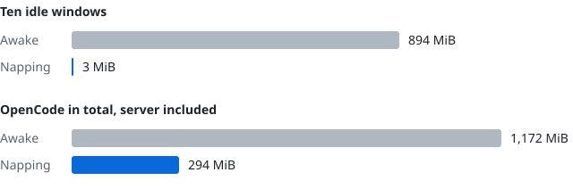

# opencode-nap

[](https://www.npmjs.com/package/opencode-nap)
[](./LICENSE)

An OpenCode 2 plugin that puts idle terminal windows to sleep to free memory, and wakes them into the same session when you come back: refocus the window, or press a key or click.



<sub>OpenCode 2.2.4 on Linux, ten windows on the start screen, measured as proportional set size (PSS), which counts memory that processes share only once. Windows with long sessions use more while awake (134 MiB each across ten long real sessions) and the same 0.3 MiB napping, so everyday savings are larger. Measure your own with <code>scripts/measure-memory.sh</code>.</sub>

Work keeps running while a window naps, because sessions live in the OpenCode server, not in the window.

It works in any terminal, inside or outside tmux, with nothing else to install.

**This plugin was not built by the OpenCode team and is not affiliated with them.**

## Install

Add it to your global `~/.config/opencode/opencode.json` or a project's `opencode.json`:

```json
{
  "plugins": ["opencode-nap"]
}
```

Restart your OpenCode windows. Each one naps after 15 minutes without input.

## Options

Use the object form in the same file to set options:

```json
{
  "plugins": [
    {
      "package": "opencode-nap",
      "options": { "idleMinutes": 10, "napOnBlur": true }
    }
  ]
}
```

| Option            | Default | Meaning                                                                          |
| ----------------- | ------- | -------------------------------------------------------------------------------- |
| `idleMinutes`     | `15`    | Minutes without input before a window naps. Fractions are allowed.               |
| `napOnBlur`       | `false` | Nap a couple of seconds after the terminal loses focus.                          |
| `blurIdleMinutes` | unset   | A shorter idle time that applies while the terminal is unfocused.                |
| `carryDraft`      | `true`  | Bring back unsent prompt text after a nap.                                       |
| `enabled`         | `true`  | Set to `false` to turn the plugin off without removing it.                       |
| `debugLogFile`    | unset   | Absolute path of a diagnostic log. It never contains prompt text.                |

Input means a key press, a paste or mouse input. The focus options need a terminal that reports focus changes; without them, only `idleMinutes` applies. A window that napped because it lost focus also wakes when you switch back to it; one that napped on `idleMinutes` waits for a key or click. An unknown or invalid option turns the plugin off.

## How it works

When a window has been idle long enough, the OpenCode process replaces itself with a tiny shell script that waits. It first draws OpenCode's logo in your theme's colours, with the working directory and a short note that the window is napping. The screen is drawn once, so it stays as it was if you resize the terminal or change the theme while the window naps; a terminal too small for it gets a line of plain text. Press any key or click to wake it: OpenCode starts again in the same window and opens the same session. The key you pressed is not sent to OpenCode.

Waking takes a second or two. A running session carries on in the server the whole time, and a permission or question prompt that comes up while the window naps is waiting for you when it wakes.

After a wake you get the same session, prompt history, open tabs, selected model and any unsent prompt text. The view starts fresh, as it does after a normal restart: scroll position resets, and the agent and model variant go back to their defaults. Attachments and images in an unsent prompt are not kept.

## When it does not nap

The plugin turns itself off for a window when napping could lose work or is not possible:

- OpenCode runs with `--standalone`, so the session lives inside the window.
- OpenCode was started with a subcommand or an option the plugin does not recognise.
- The platform is not macOS or Linux, or the terminal is not a real terminal.
- An OpenCode internal the plugin relies on has changed.

It waits and tries again a few seconds later while an external editor has the terminal, or while unsent prompt text cannot be saved.

## Platforms

macOS and Linux. On Windows the plugin does nothing.

## Development

```sh
bun install
npm run ci:check   # lint, typecheck, unit tests
npm run build
npm run test:e2e   # drives real OpenCode windows against a local fake model
```

The end-to-end runner builds and installs the packed package once, then runs up to eight isolated test processes. Long files are split into complementary groups, so every case still runs. Processes share only installed dependencies: each gets its own HOME, XDG directories, project, temporary files and private servers. Short idle settings exercise the real nap timers without waiting minutes. The tests never call a hosted model.

## License

MIT. See [LICENSE](LICENSE).
